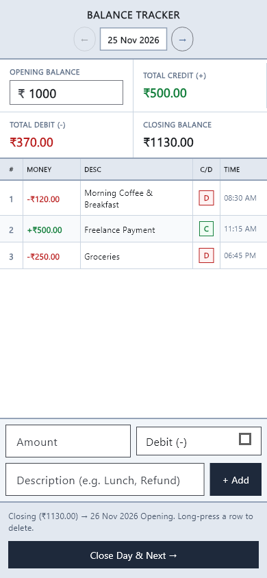

# Balance Tracker

An Excel-style daily balance tracker built with **Flutter**. Enter your opening balance, log credits and debits throughout the day, and automatically carry forward the closing balance as the next day's opening balance.

## Preview



## Features

- **Excel-Style Sheet**: Clean grid layout with `#` (S.No), `MONEY`, `DESC`, `C/D` (`C` for Credit / `D` for Debit), and `TIME` (automatically captured when an entry is added).
- **Automatic Balance Carry-Forward**: End-of-day closing balance automatically becomes the next calendar date's opening balance. Edits to earlier entries propagate forward.
- **Today-Only Editing**: Only today's sheet is editable; past and future dates are view-only to preserve historical integrity.
- **Long-Press to Delete**: Long-press any row on today's sheet to reveal the delete confirmation bar.
- **Phone-First Layout**: All 5 columns fit cleanly on mobile screens without horizontal scrolling, paired with a 2-row quick-entry form.
- **Local Persistence**: All daily records are saved locally on-device using `shared_preferences`.

## Getting Started

### Prerequisites

- Flutter SDK (`>= 3.13.5` Dart SDK)

### Run Locally

```bash
flutter pub get
flutter run
```

### Run Checks & Tests

```bash
flutter analyze
flutter test
```

## Deployment

### Android (APK / Play Store App Bundle)

```bash
# Release APK
flutter build apk --release

# Play Store App Bundle
flutter build appbundle --release
```

### iOS

```bash
flutter build ios --release
```

### Web

```bash
flutter build web --release
```

### Windows

```bash
flutter build windows --release
```

## Project Structure

- `lib/main.dart` — App entry point and theme configuration
- `lib/models/balance_models.dart` — `TransactionEntry`, `DayRecord`, and date/time helpers
- `lib/services/balance_controller.dart` — State management, carry-forward logic, and `SharedPreferences` persistence
- `lib/screens/balance_sheet_screen.dart` — Responsive Excel-style UI
- `test/widget_test.dart` — Unit and widget tests
- `index.html` — Original interactive HTML wireframe
